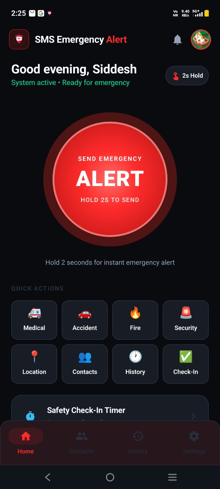
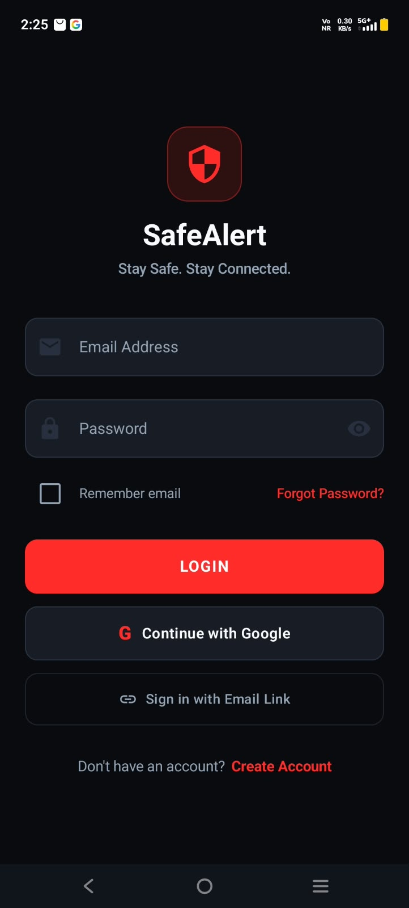
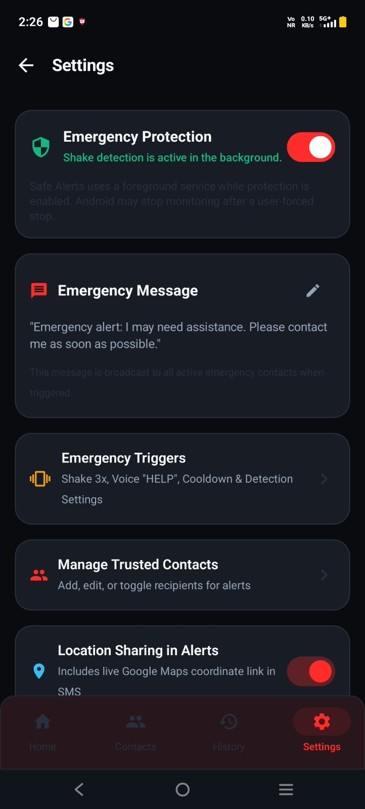
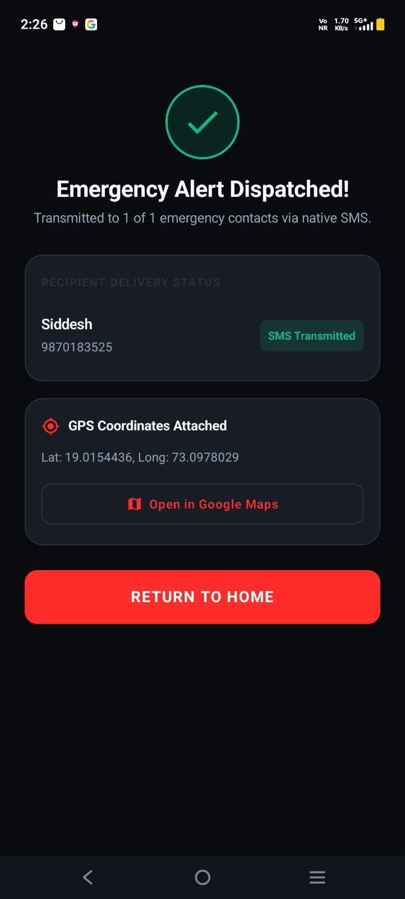

# 🛡️ SafeAlerts — SMS Emergency Alert System

<p align="center">
  
</p>

<p align="center">
  <strong>Stay Safe. Stay Connected.</strong><br>
  A native Android emergency alert application for quickly notifying trusted contacts through SMS with the user's location.
</p>

<p align="center">
  
  
  
  
  
</p>

---

## 📱 About SafeAlerts

**SafeAlerts** is a native Android personal-safety application designed to help users quickly communicate an emergency to trusted contacts.

The main SOS flow uses a deliberate **2-second hold** to reduce accidental activation. When an alert is dispatched, the application can send an emergency SMS containing the user's location and a Google Maps link to enabled trusted contacts.

The application also provides safety check-ins, emergency trigger settings, trusted-contact management, alert history, and authentication.

> **Important:** SafeAlerts is a communication/safety tool, not a replacement for local emergency services.

---

## ✨ Features

### 🚨 Emergency SOS
- Large emergency alert button.
- 2-second hold-to-send interaction.
- Countdown/cancellation flow to help prevent accidental alerts.
- Emergency dispatch status screen.
- Support for different emergency situations such as:
  - 🏥 Medical
  - 🚗 Accident
  - 🔥 Fire
  - 🚨 Security

### 📍 Location Sharing
- Uses Android location services to obtain the user's coordinates.
- Generates a Google Maps location link.
- Location sharing can be enabled/disabled from Settings.
- If location is unavailable, the alert can continue without crashing.

### 📲 Native SMS Alerts
- Uses Android `SmsManager` for direct SMS transmission when permitted.
- Supports an Android SMS Composer fallback when direct SMS is unavailable.
- Emergency messages can be customized.
- Alerts can be sent to active trusted contacts.

### 👥 Trusted Contacts
- Add contacts manually.
- Import contacts using the Android contact picker.
- Enable or disable individual emergency contacts.
- Contacts are stored under the authenticated user's Firestore data.

### ⏱️ Safety Check-In
- Create timed safety sessions.
- Available durations include 15 minutes, 30 minutes, 1 hour, and custom durations.
- Check in with an **I'm Safe** action before the timer expires.
- Android alarms/notifications support the check-in workflow.

### 📜 Alert History
- View previously dispatched alerts.
- See recipient information, timestamp, delivery method, and location status.
- Open an attached location in Google Maps.

### ⚙️ Settings
- Emergency Protection / background protection.
- Custom emergency message.
- Emergency trigger configuration.
- Trusted contact management.
- Location-sharing preference.
- Countdown and activation settings.
- Theme and haptic preferences.

### 🔐 Authentication
- Email/password login.
- Passwordless email-link sign-in.
- Google Sign-In.
- Forgot-password flow.
- Firebase Authentication.

---

## 🖼️ Screenshots

### 🔐 Login

<p align="center">
  
</p>

### 🏠 Home Dashboard

<p align="center">
  
</p>

### ⚙️ Settings

<p align="center">
  
</p>

### ✅ Emergency Alert Dispatched

<p align="center">
  
</p>

---

## 🛠️ Tech Stack

| Technology | Purpose |
|---|---|
| **Kotlin 1.9.24** | Android application development |
| **Jetpack Compose** | Modern Android UI |
| **Material 3** | UI components and theming |
| **MVVM** | Application architecture |
| **StateFlow + Coroutines** | Reactive state management |
| **Firebase Authentication** | User authentication |
| **Cloud Firestore** | Trusted contacts and alert data |
| **Jetpack DataStore** | Local user preferences |
| **SmsManager** | Native SMS transmission |
| **FusedLocationProviderClient** | GPS/location retrieval |
| **AlarmManager / BroadcastReceiver** | Safety check-in scheduling |
| **TelephonyManager** | SIM/network readiness checks |

---

## 🏗️ Architecture

SafeAlerts follows an **MVVM + Repository** architecture.

```text
Android App
│
├── UI — Jetpack Compose + Material 3
│
├── ViewModels
│   ├── AuthViewModel
│   ├── HomeViewModel
│   ├── SosViewModel
│   └── Other feature ViewModels
│
├── Repositories
│   ├── AuthRepository
│   ├── ContactsRepository
│   └── AlertsRepository
│
├── Services
│   ├── LocationService
│   ├── SmsSender
│   └── SafetyCheckInManager
│
└── Firebase
    ├── Authentication
    └── Cloud Firestore
```

---

# 🚀 Getting Started

## 1. Prerequisites

Install the following before running the project:

- **Android Studio** — Jellyfish, Koala, Ladybug or newer
- **JDK 17**
- Android SDK
- A physical Android phone running **Android 8.0 / API 26 or higher**
- An active SIM card for real SMS testing
- A Firebase project configured for the application

A physical phone is recommended because SMS, SIM status, and some location/background features cannot be fully tested using an emulator.

---

# 📥 2. Clone the Repository

Open PowerShell, Command Prompt, or Git Bash and run:

```bash
git clone https://github.com/corsal2006/SafeAlerts
```

Then enter the project:

```bash
cd safealerts
```

Example:

```bash
git clone https://github.com/YOUR_USERNAME/safealerts.git
cd safealerts
```

Replace `<YOUR_GITHUB_REPO_URL>` with the actual GitHub repository URL.

---

# 🤖 3. Open in Android Studio

1. Open **Android Studio**.
2. Select **File → Open**.
3. Select the cloned `safealerts` folder.
4. Wait for **Gradle Sync** to finish.
5. Make sure Android Studio detects the Android SDK and JDK 17.
6. Select the `app` configuration.
7. Select your connected Android phone from the device dropdown.
8. Click **Run ▶**.

Android Studio will build and install the application on the selected device.

---

# 📱 4. Connect Your Android Phone

## Method A — USB Cable

### On your phone

1. Open **Settings**.
2. Go to **About Phone**.
3. Tap **Build Number** 7 times to enable Developer Options.
4. Go back to Settings.
5. Open **Developer Options**.
6. Enable **USB Debugging**.
7. Connect the phone to your computer using a USB cable.
8. Accept the **Allow USB debugging** prompt on the phone.

### In Android Studio

Your phone should appear in the device selector at the top.

Select it and press:

```text
Run ▶
```

---

## Method B — Wireless Debugging

If your Android version and Android Studio support wireless debugging:

1. Enable **Developer Options**.
2. Enable **Wireless Debugging**.
3. Make sure the phone and computer are on the same Wi-Fi network.
4. In Android Studio, use the device pairing option.
5. Pair the phone using the displayed QR code or pairing code.
6. Select the phone in Android Studio.
7. Press **Run ▶**.

For SMS testing, the phone still needs a working SIM/mobile network.

---

# 🔥 5. Firebase Configuration

The Android package used by the project is:

```text
com.siddesh.smsalerts
```

The Firebase configuration file is:

```text
app/google-services.json
```

If you are using the existing Firebase project, make sure this file is present in:

```text
safealerts/
└── app/
    └── google-services.json
```

If you create your own Firebase project, download its Android `google-services.json` and replace the existing configuration with your own project's configuration.

### Enable Authentication Providers

In Firebase Console, enable the authentication methods required by the application:

- Email/Password
- Email Link / Passwordless Sign-In
- Google

For Google Sign-In on a new machine or Firebase Android app, configure the appropriate SHA-1 and SHA-256 fingerprints.

Generate the signing report with:

```powershell
.\gradlew.bat signingReport
```

Then add the required fingerprints in:

**Firebase Console → Project Settings → Your Android App**

---

# 🗄️ 6. Firestore

SafeAlerts stores user-specific information in Cloud Firestore.

The main data structure is:

```text
users/{uid}
│
├── trustedContacts/{contactId}
│
└── alerts/{alertId}
```

Use the `firestore.rules` file included in the repository as the starting point for your Firestore security configuration.

Do not expose Firebase credentials or private configuration outside the intended application configuration.

---

# 🔐 7. Android Permissions

Depending on the enabled features, Android may request permissions for:

- Location
- SMS
- Contacts
- Notifications
- Phone/SIM-related functionality

Grant permissions when testing the corresponding features.

For real emergency SMS testing, use a physical device with an active SIM.

---

# ▶️ 8. Run from Terminal

From the project root:

```powershell
cd safealerts
```

Run unit tests:

```powershell
.\gradlew.bat testDebugUnitTest
```

Build the debug APK:

```powershell
.\gradlew.bat assembleDebug
```

The generated APK will be located at:

```text
app\build\outputs\apk\debug\app-debug.apk
```

To install it on a connected device:

```powershell
adb install -r app\build\outputs\apk\debug\app-debug.apk
```

---

# 🧪 Testing

The project includes unit tests for core functionality.

```text
AuthValidationTest
EmergencyMessageBuilderTest
ContactValidationTest
SafetyCheckInTest
```

Run:

```powershell
.\gradlew.bat testDebugUnitTest
```

The current project documentation reports:

```text
18 tests
0 failures
100% successful
```

---

# 📂 Project Structure

```text
safealerts/
├── app/
│   ├── google-services.json
│   ├── build.gradle.kts
│   └── src/
│       └── main/
│           ├── AndroidManifest.xml
│           ├── java/com/siddesh/smselerts/
│           │   ├── SafeAlertApp.kt
│           │   ├── MainActivity.kt
│           │   ├── data/
│           │   ├── service/
│           │   ├── ui/
│           │   └── utils/
│           └── res/
│
├── screenshots/
├── firestore.rules
├── build.gradle.kts
├── settings.gradle.kts
├── gradle.properties
├── gradlew.bat
└── README.md
```

---

# ⚠️ Troubleshooting

### Phone is not detected

Check:

```text
Developer Options → USB Debugging → ON
```

Then reconnect the USB cable and accept the debugging authorization prompt.

You can also check ADB:

```bash
adb devices
```

Your device should appear in the list.

### Gradle build fails

Try:

1. Make sure JDK 17 is selected.
2. Run **File → Sync Project with Gradle Files**.
3. Make sure Android SDK components are installed.
4. Run:

```powershell
.\gradlew.bat clean
.\gradlew.bat assembleDebug
```

### SMS is not sent

Check:

- The phone has an active SIM.
- The device has mobile network service.
- SMS permission is granted where required.
- The recipient number is valid.
- Direct SMS is enabled if using the direct `SmsManager` path.

The application also contains an SMS Composer fallback when direct SMS transmission is unavailable.

### Google Sign-In does not work

Verify:

- The package name matches `com.siddesh.smsalerts`.
- Google authentication is enabled in Firebase.
- The correct SHA-1/SHA-256 fingerprints are registered.
- `google-services.json` belongs to the correct Firebase Android application.

---

# 🔒 Privacy & Security

SafeAlerts handles sensitive information such as:

- Emergency contacts
- Location coordinates
- Alert history
- Authentication information

Use appropriate Firebase security rules and avoid committing private credentials or secrets to a public repository.

---

# ⚠️ Safety Notice

SafeAlerts is intended as a personal safety and emergency communication application.

SMS delivery, GPS availability, mobile network coverage, Android background restrictions, device permissions, and carrier behavior can affect emergency communication. Users should not rely on the application as their only emergency response mechanism.

---

# 📄 License

Developed as a native Android Emergency Alert System for personal safety and academic/project research purposes.

You are free to extend and modify the project according to your own requirements.

---

## 👨‍💻 Developer

**Siddesh Naik**

Built with:

```text
Kotlin • Jetpack Compose • Firebase • Firestore • Android APIs
```
